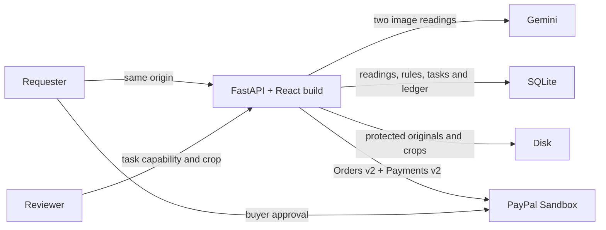

# HumanBridge

HumanBridge reads a receipt twice with Gemini, tells a requester which values need another look, and lets them authorize a budget for a verification service. The requester sees the original readings and the reviewer's answer before deciding whether to pay. The application uses PayPal Sandbox.

## Run the judge demo locally

Use Windows PowerShell, Python 3.10 or 3.11, Node 22, npm and Chrome. Start in an empty parent directory.

```powershell
git clone https://github.com/JASHoswal1234/humanBridge.git
cd humanBridge
python -m venv .venv
.\.venv\Scripts\python.exe -m pip install -r backend/requirements.txt
npm.cmd --prefix frontend ci
npm.cmd --prefix frontend run build
Copy-Item backend/.env.example backend/.env
```

For an existing checkout, keep its existing private environment file. Set GEMINI_API_KEY and GEMINI_MODEL in backend/.env. Enter a Sandbox merchant app's PAYPAL_CLIENT_ID and PAYPAL_CLIENT_SECRET there. Use a separate personal Sandbox buyer for approval. Credentials belong on the server. Scripted examples and deterministic tests work without provider keys.

```powershell
.\.venv\Scripts\python.exe -m uvicorn api:app --app-dir backend --host 127.0.0.1 --port 8000 --workers 1 --no-access-log
```

Open http://127.0.0.1:8000 in the same browser throughout. FastAPI serves the compiled frontend, relative API URLs and PayPal callbacks on that origin. Local storage defaults to backend/data. Keep this directory and your original browser profile to revisit a batch. Rebuild before restarting the server after UI edits.

1. Choose **New live batch**. Download the synthetic sample from the empty upload panel or use [synthetic receipt A](evaluation/A.png). Upload it and choose **Analyze**.
2. Compare both Gemini readings and the printed receipt. Review is conditional. When no check fires, explain the result and finish without checkout. For a live example with a genuinely obscured component, try the [synthetic folded receipt](evaluation/challenge/fold.png). Both recorded totals were correct, but the readings disagreed on subtotal. A new run can differ. **Load scripted demo** is a separate walkthrough.
3. For a flagged batch create the USD 5 authorization order. Open Sandbox checkout, approve as the buyer, return to the same origin and follow the authorization control. The backend verifies the order with PayPal.
4. Open the reviewer task, inspect its image crop, submit a value and return to the requester tab. Compare the evidence, request revision or accept. A conflicting correction requires an explanation. Acceptance approves the service fee.
5. Confirm final capture for accepted work. The server reads back the capture result. If no work was accepted, use the available void action once remaining tasks are resolved. Refresh to inspect persisted settlement.

## Architecture



Gemini extracts schema-validated fields. Missing values stay missing. Deterministic rules compare total, merchant, dates, line items and arithmetic, including explicit discounts. The same model can repeat an error. Rule agreement supplies no calibrated probability. [Evaluation and reproduction](evaluation/README.md)

The backend creates an AUTHORIZE order, verifies buyer approval, authorizes USD 5 and checks the authorization against the order. It calculates fees in integer cents, uses stable request identifiers and requests one final capture up to the accepted amount and budget. The configured verification-service merchant receives the payment. The earlier completed app run captured **USD 0.75**. A local checkout starts with a fresh ledger. [Sanitized evidence](docs/PROJECT_STATUS.md)

## Verify the installation

From the repository root, with Chrome installed, add the venv to this shell's PATH so the integration harness uses the same Python as the server.

```powershell
$env:Path = (Resolve-Path .venv/Scripts).Path + ';' + $env:Path
Push-Location backend
python -m pytest -q
Pop-Location
Push-Location frontend
npm.cmd test
npm.cmd run build
node tests/settlement.mjs
Pop-Location
python evaluation/benchmark.py score --human evaluation/human.json
```

The backend and browser suites use controlled provider responses. The settlement journey exercises real HTTP, cookie permissions, React and SQLite. An optional independent check, `node tests/live-gemini.mjs` from frontend, makes two real Gemini calls on the synthetic sample and compares persisted responses after refresh.

## Security and operation

Use synthetic or non-sensitive receipts. Images travel to Gemini. Batch-owner cookies are HttpOnly and path scoped. Reviewer capabilities give access to one task and its crop. Anyone with a reviewer link can use it. HTTPS deployments set Secure cookies. Do not share browser profiles, reviewer links, databases, private environment files or checkout recordings containing buyer details. Access logging is disabled in the documented start command. This prototype has no account recovery, public quota control or automated retention policy. Set a provider quota and monitor use before distributing a public URL. The free Render preview uses ephemeral storage and disables payments. Use the local installation for persistent Sandbox settlement. Two sequential model calls with retries can take several minutes.

[Render deployment and smoke test](docs/RENDER.md) · [Demo script and recording checklist](docs/DEMO_VIDEO.md) · [Project evidence](docs/PROJECT_STATUS.md) · [MIT license](LICENSE)
